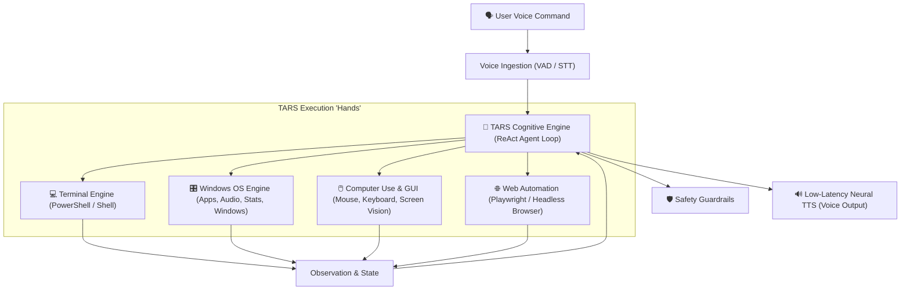

# TARS — Autonomous Voice-Driven OS Control Agent 🤖

> *"Honesty, new parameter: ninety percent. Humor: seventy-five percent."* — TARS, *Interstellar*

**TARS** is an autonomous, voice-driven digital companion and computer-use agent designed to take over your PC and perform tasks entirely by voice. Built with low-latency speech pipelines, multi-modal reasoning, and comprehensive OS-level execution engines, TARS can operate the terminal, interact with native Windows applications, browse the web, and manage system resources seamlessly.

---

## ⚡ Core Capabilities



### 1. Terminal & Developer Control
- Runs arbitrary PowerShell or CMD commands in real time with continuous streaming output.
- Automates Git workflows (`status`, `commit`, `push`, `pull`, branch management).
- Launches, monitors, and terminates background developer servers, build tools, and scripts.

### 2. Native Windows OS Automation
- Launches, focuses, minimizes, maximizes, and terminates native desktop applications.
- Master volume, mute, and media key controls (play/pause/next/previous).
- Real-time hardware telemetry: CPU, RAM, battery, active processes, and disk metrics.
- Clipboard manipulation (read, copy, paste).

### 3. GUI & Computer-Use (Visual Autopilot)
- Takes high-resolution screenshots and analyzes active window state using multi-modal AI.
- Controls mouse cursor (click, right-click, double-click, drag-and-drop, scroll).
- Keyboard synthesis (natural typing, hotkey shortcuts like `Ctrl+C`, `Alt+Tab`, `Win+D`).

### 4. Web Automation Engine
- Autonomous browsing with Playwright.
- Searches Google, extracts web page content, fills forms, navigates dynamic web apps, and downloads files.

### 5. Low-Latency Voice Interface
- Real-time Voice Activity Detection (VAD) and fast speech-to-text.
- Microsoft Neural TTS integration (`edge-tts`) providing crisp, human-like voice synthesis with zero subscription cost.
- Instant verbal acknowledgments during multi-step execution.

### 6. Safety Guardrails & Human-in-the-Loop
- Hardened protection against catastrophic commands (e.g. `rmdir /s /q C:\`, disk formatting, registry alteration).
- Configurable approval tiers: safe commands execute autonomously, destructive actions require explicit verbal confirmation.

---

## 📁 Project Architecture

```
TARS/
├── config/
│   ├── settings.yaml          # Core configuration (voice, LLM model, thresholds)
│   └── safety_rules.json      # Command blacklists and confirmation rules
├── core/
│   ├── brain.py               # ReAct agent loop, tool routing & reasoning
│   ├── personality.py         # TARS persona prompt & humor/honesty matrix
│   ├── memory.py              # Persistent SQLite/JSON episodic memory
│   ├── voice_listener.py      # Audio input, wake word & STT stream
│   └── voice_speaker.py       # Asynchronous neural TTS playback
├── tools/
│   ├── safety.py              # Security validator for destructive actions
│   ├── terminal_tools.py      # PowerShell command runner & process manager
│   ├── os_tools.py            # Windows OS, volume, apps, and hardware telemetry
│   ├── gui_tools.py           # Mouse, keyboard, and screenshot capture
│   └── browser_tools.py       # Playwright browser agent & web search
├── tests/                     # Automated unit and integration tests
├── main.py                    # Futuristic terminal HUD & runtime entrypoint
├── requirements.txt           # Python dependencies
└── README.md                  # Project documentation
```

---

## 🚀 Quickstart Guide

### 1. Prerequisites
- **Operating System:** Windows 10/11 (PowerShell 5.1 or 7+)
- **Python:** 3.10+ (Tested on Python 3.12)
- **Microphone & Speakers** for full voice mode

### 2. Installation
```powershell
# Clone the repository
git clone https://github.com/Shafyydev/TARS.git
cd TARS

# Create and activate virtual environment
python -m venv venv
.\venv\Scripts\Activate.ps1

# Install dependencies
pip install -r requirements.txt
```

### 3. Configuration
Copy `.env.example` to `.env` and provide your API keys:
```ini
GEMINI_API_KEY=your_gemini_api_key_here
# Optional alternatives:
OPENAI_API_KEY=
GROQ_API_KEY=
```

### 4. Running TARS
```powershell
# Run with interactive terminal HUD & voice synthesis
python main.py

# Run in text-only debug mode
python main.py --text-only
```

---

## ⚙️ Persona Configuration

In `config/settings.yaml`, adjust TARS's behavioral matrix on the fly:
```yaml
personality:
  name: "TARS"
  humor: 0.75        # 0.0 to 1.0
  honesty: 0.90      # 0.0 to 1.0
  sarcasm: 0.60      # 0.0 to 1.0
  verbosity: "concise" # "concise", "normal", "detailed"
```

---

## 🛡️ License
MIT License. Built by [Shafyydev](https://github.com/Shafyydev).
